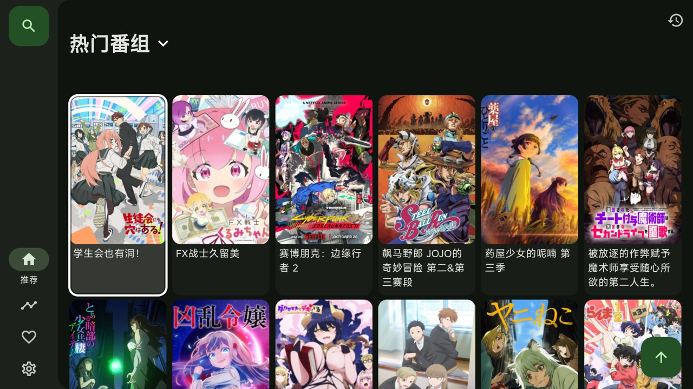
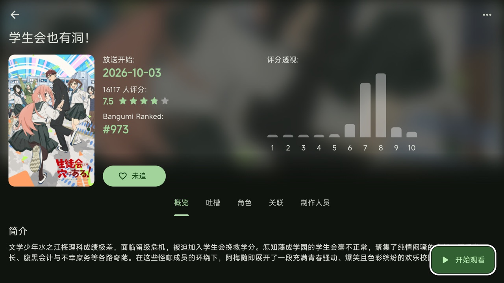
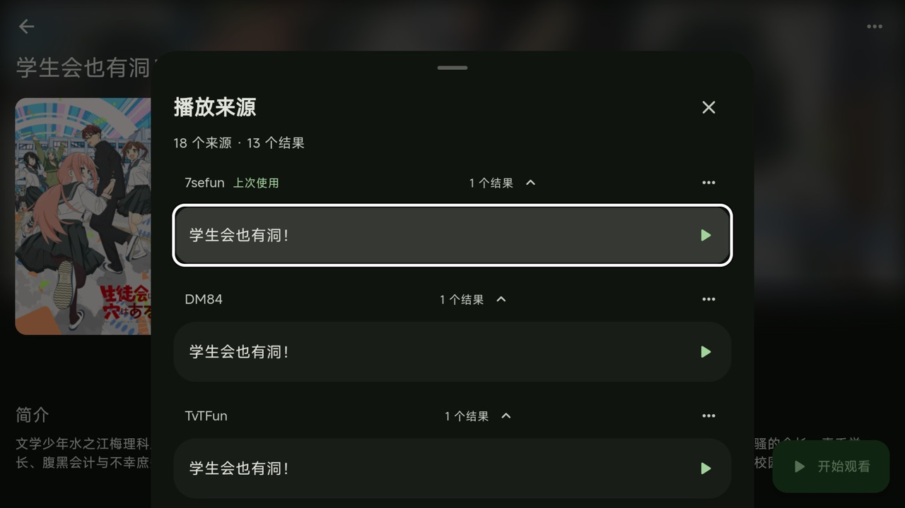
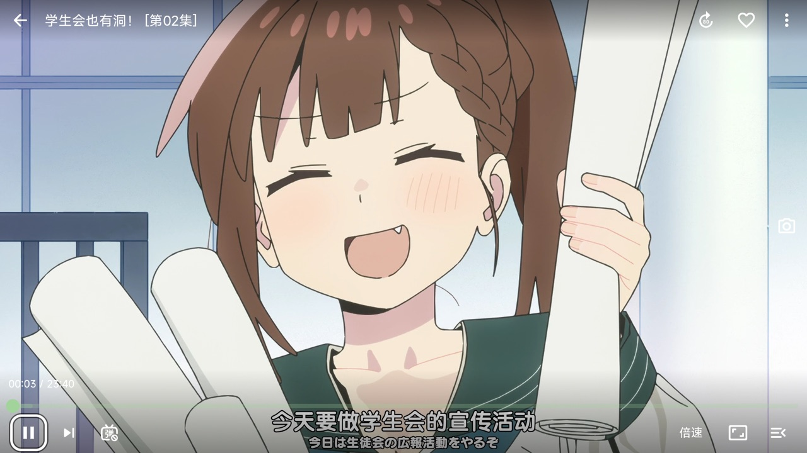
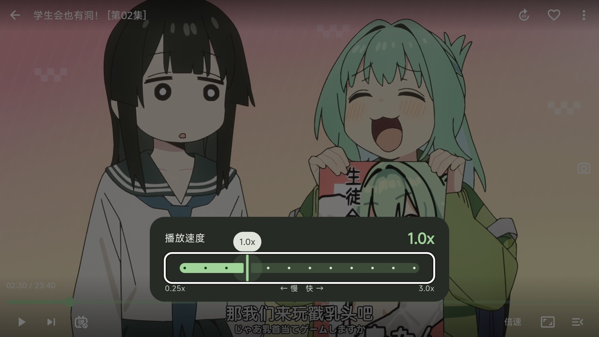
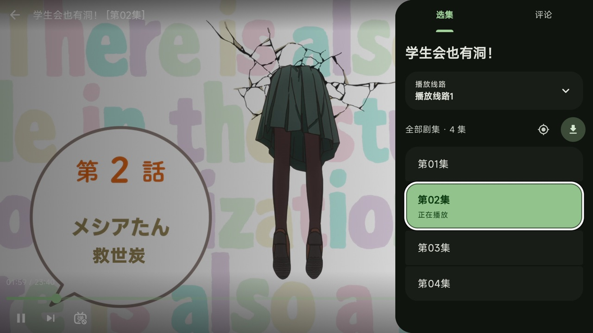

# Kazumi TV

Kazumi 的 Android TV 版：用遥控器找番、选片源、看番。基于 [Predidit/Kazumi](https://github.com/Predidit/Kazumi) 2.4.2。

## 致谢

Kazumi 由 [Predidit](https://github.com/Predidit) 和 [Kazumi 的各位贡献者](https://github.com/Predidit/Kazumi/graphs/contributors) 开发和维护。规则系统、播放器、弹幕、Bangumi 元数据和同步，这个仓库里绝大部分代码都出自他们之手，这里做的是在其基础上的电视适配。感谢原作者把 Kazumi 开源，让它也能在电视上用起来。

Kazumi 本身受益于 [XpathSelector](https://github.com/simonkimi/xpath_selector)、[弹弹play 开放平台](https://www.dandanplay.com/)、[Bangumi 开放 API](https://bangumi.tv/) 和 [Anime4K](https://github.com/bloc97/Anime4K)，在此一并致谢。

Kazumi 主线面向手机和电脑，电视版在这个仓库独立维护。电视上遇到的问题请在 [本仓库的 Issues](https://github.com/PenguinMiaou/Kazumi-TV/issues) 反馈。

## 截图

| 首页 | 详情页 |
| --- | --- |
|  |  |
| **片源列表** | **播放控制栏** |
|  |  |
| **倍速面板** | **选集面板** |
|  |  |

## 电视适配

**桌面入口**
- 出现在 Google TV 的应用列表，带电视横幅

**遥控器导航**
- 全局焦点框，贴合按钮和卡片的形状
- 方向键可以在左侧导航栏和页面内容之间切换
- 首页默认聚焦第一部番，详情页默认聚焦开始观看
- 设置里的单选项、菜单都能用方向键逐项选择
- 返回键先关闭菜单和弹层，再返回上一页

**播放器**
- 上下键呼出控制栏，确认键暂停或继续，左右键快退快进，控制栏隐藏时也有提示
- 进度条左右每次 10 秒，按住每次 30 秒
- 遥控器音量键显示播放器自带的音量提示
- 倍速是一条滑条，左右每次 0.25x；定时关闭是选项框
- 选集面板打开时直接定位到当前集
- 去掉了电视用不上的锁定、画中画和超分辨率

**片源列表**
- 有结果的片源默认展开，排在前面，焦点直接落在第一个结果上
- 上次使用的片源排在最前，并标出"上次使用"

**性能**

在 TCL Google TV（Android 12，32 位，Realtek，1.8 GB 内存）上实测：

| 场景 | 改动前 | 改动后 |
| --- | --- | --- |
| 首页滚动 | 约 26 帧 | 约 55 帧 |
| 播放 1080p 的 CPU | 约 2.3 核 | 0.25 到 0.6 核 |
| 播放掉帧 | 前几分钟 600 帧 | 0 帧 |
| 首页内存 | 134 MB | 119 MB |

对应的改动：封面采样改为 `FilterQuality.low`；前台预读 300 秒，缓冲上限 128 MiB；安卓渲染器默认 `mediacodec_embed`；图片缓存上限 48 MiB；视频地址解析完成后释放 WebView。

每一项改动的细节见 [提交记录](https://github.com/PenguinMiaou/Kazumi-TV/commits/main)。

## 安装

在 [Releases](https://github.com/PenguinMiaou/Kazumi-TV/releases) 下载安装包：32 位电视（大多数电视）装 `armeabi-v7a`，64 位电视装 `arm64-v8a`。可以用 U 盘拷到电视上安装，也可以打开电视的 ADB 调试，用 `adb install` 安装。

包名是 `io.github.penguinmiaou.kazumitv`，应用名 Kazumi TV，和官方 Kazumi 可以同时安装。应用内的检查更新会从本仓库的 Releases 下载和电视匹配的安装包。

## 编译

需要 Flutter 3.47.7（和 Kazumi 2.4.2 一致）和 Android SDK，其余环境要求见上游的 [贡献指引](static/doc/CONTRIBUTING.md)。

```bash
flutter pub get
flutter build apk --release --split-per-abi --target-platform android-arm,android-arm64
# 输出在 build/app/outputs/flutter-apk/
```

发布签名从 `android/key.properties` 读取（`storeFile`、`storePassword`、`keyAlias`、`keyPassword`）。没有这个文件时使用调试签名。

## 许可证

本项目沿用 Kazumi 的 [GNU 通用公共许可证第 3 版（GPL-3.0）](LICENSE)。

应用图标来自 [Yuquanaaa](https://www.pixiv.net/users/66219277) 发表在 [Pixiv](https://www.pixiv.net/artworks/116666979) 上的作品，版权归原作者所有，Kazumi 项目已获得原作者授权使用。电视横幅是纯文字设计，没有使用这幅作品。

内嵌字体为 [Mi Sans](https://hyperos.mi.com/font/zh/details/sc/)，由 [Xiaomi](https://www.mi.com/index.html) 开发和拥有版权。

和上游一样，本项目不收集任何用户数据，不使用任何遥测组件。
